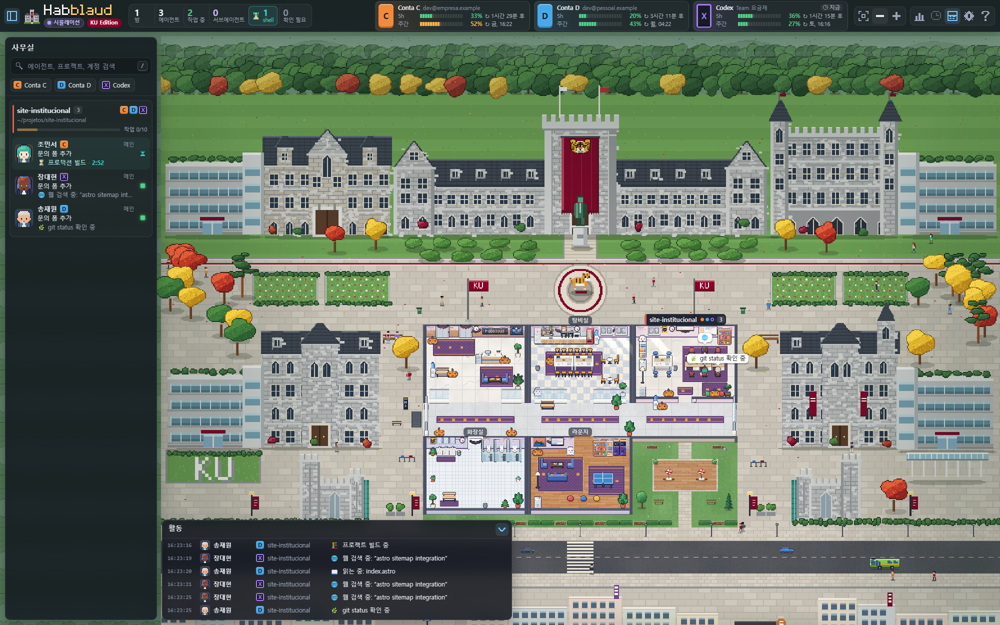

# Habblaud · KU Edition

고려대학교 캠퍼스 버전으로 꾸민 [Habblaud](https://github.com/marmottajr/habblaud) 개인용 포크입니다.
Habblaud는 Claude Code(와 Codex) 에이전트를 픽셀 아트 사무실로 보여 주는 로컬 웹 앱입니다.
**Habblaud 자체의 소개·기능·사용법·설정은 원본 저장소를 보세요: https://github.com/marmottajr/habblaud**
이 저장소에는 KU Edition의 설치 방법과 원본에서 바뀐 점만 적습니다.

기준 버전은 원본 0.11.0(커밋 `4ccce25`)이고, 라이선스는 원본과 같은 MIT입니다(`LICENSE`).
원작자(Márcio Junior)의 저작권 고지와 MIT 라이선스 전문은 `LICENSE`에 그대로 있습니다.

> **비공식 개인 프로젝트입니다.** 고려대학교, Anthropic, 서울교통공사와 관련이 없고 승인이나 후원을 받은 것도 아닙니다.
> 학교 이름·호랑이 상징·건물 모습·지하철 표시는 직접 그린 픽셀 아트로 표현한 팬 작품이며, 사진이나 공식 로고·교표 파일은 쓰지 않았습니다.
> 관계자의 요청이 있으면 해당 부분을 바로 삭제하거나 고칩니다. "Claude Code"는 Anthropic의 제품 이름이고, "Habblaud"는 원본 프로젝트의 이름입니다.



## 설치 (Windows 11, Docker 없이)

필요한 것: [Node.js](https://nodejs.org) 22.12 이상, Git, Chrome 또는 Edge. 에이전트 목록은 PC에 설치된 Claude Code의 세션을 읽어서 채워집니다.
개발·확인은 Node 24, Windows 11에서 했습니다.

PowerShell에서 실행하세요. `npm`이 아니라 `npm.cmd`를 쓰는 이유는 PowerShell 실행 정책이 `npm.ps1`을 막는 PC가 많기 때문입니다.

```powershell
git clone https://github.com/hecksin-byte/habblaud-ku-edition.git
cd habblaud-ku-edition
npm.cmd install
npm.cmd run build
$env:HABBLAUD_LANG = 'ko'
node dist\server\index.js
```

브라우저에서 <http://127.0.0.1:4747> 을 엽니다. 에이전트가 없어도 화면만 보고 싶으면 <http://127.0.0.1:4747/?mock=1> 로 열면 가상 에이전트가 나옵니다.
`HABBLAUD_LANG=ko`는 에이전트 활동 문구를 한국어로 만드는 서버 설정입니다. 화면의 한국어는 브라우저·설정 화면의 언어 선택을 따릅니다.

코드를 바꾼 뒤에는 `npm.cmd run build`를 다시 하고 서버를 재시작해야 반영됩니다. 클라이언트만 바꿨다면 재빌드만으로 충분합니다.

### 컴퓨터를 켜면 자동 실행

Windows에 로그인할 때 서버가 저절로 뜨게 하는 설정입니다. 작업 스케줄러에 `Habblaud Server` 항목을 만들고, 서버는 숨김 창으로 실행됩니다.
로그는 `%USERPROFILE%\.habblaud\server.log`, `server.err.log`에 남습니다.

켜고 끄는 방법은 두 가지입니다.

- **화면에서:** Habblaud 오른쪽 위 ⚙ 설정 → 맨 아래 **자동 실행 → "컴퓨터를 켜면 자동 실행"** 스위치. Windows에서, 이 PC의 브라우저로 열었을 때만 보입니다.
- **명령으로:**

```powershell
powershell -ExecutionPolicy Bypass -File scripts\windows\autostart.ps1 -Action on      # 켜기(항목이 없으면 만듦)
powershell -ExecutionPolicy Bypass -File scripts\windows\autostart.ps1 -Action off     # 끄기(항목은 남기고 비활성화)
powershell -ExecutionPolicy Bypass -File scripts\windows\autostart.ps1 -Action status  # 상태를 JSON으로 확인
```

끄더라도 지금 떠 있는 서버는 꺼지지 않습니다. 이미 4747 포트에서 서버가 돌고 있으면 자동 실행은 두 번 띄우지 않고 그냥 끝납니다.

## 바뀐 점

### 캠퍼스 월드

- **고려대 캠퍼스 배경:** 본관(고딕 석조 건물, 중앙 탑에 호랑이 현수막과 동상), 좌우 별관, 정문, 광장과 호랑이 메달, 숲 배경, 자연계 캠퍼스 건물(유리 파빌리온, "KU" 잔디 글자), 남쪽 상가와 횡단보도, 그리고 길 양쪽 인도의 **안암역 출구 2곳(6호선 표시)과 버스 정류장 2곳**. 사무실은 광장 한가운데에 놓입니다.
- **밤 조명:** 밤에는 학교 곳곳의 가로등(본관 앞 깃발 가로등, 양쪽 인도의 가로등)이 켜지고, 본관·별관·자연계 건물·상가의 창문이 대부분(약 70%) 불을 밝힙니다. 어느 창이 켜질지는 위치로 정해져서 깜빡이지 않습니다.
- **나무:** 건물 위에 올라가지 않도록 건물 영역과 겹치는 자리에는 심지 않고, 벤치는 나무 뒤에 오도록 그리는 순서를 맞췄습니다.
- **카메라:** 월드 전체를 한 번에 볼 수 있습니다. `−` 키(또는 버튼)를 한 번 누르면 화면 너비에 맞춰 위쪽을 기준으로 전체를 보여 줍니다. 에이전트를 눌러 이동할 때는 최대 2배까지만 확대합니다.
- **로고·아이콘:** 헤더의 로고와 파비콘, 앱 아이콘을 고딕 석조 본관 모양으로 바꿨고, 헤더 왼쪽 위에 **KU Edition** 배지를 넣었습니다.

### 사무실 내부 (실제 연구실·열린도서관 참고)

- 실제 대학원 연구실, 복도, 열린도서관 라운지, 1층 공동현관 사진과 고려대 강의실 사진을 눈으로 참고해 사무실 인테리어를 바꿨습니다. 사진 파일은 저장소에 넣지 않았고, 모두 코드로 그린 픽셀 아트입니다.
- **프로젝트 방(연구실):** 방마다 모습이 다릅니다. 실제 연구실 쪽(회색 비닐 장판, 너도밤나무 색 책상과 헤드폰 걸린 책장, 메시·흰 의자, 옷걸이, 소화기)과 원본 Habblaud 쪽(밝은 대리석 바닥, 방 색 러그, 흰색·나무·어두운 책상, 색색 의자)을 번갈아 섞었습니다. 벽 색·무늬(무늬목 포함), 반쯤 내린 롤 블라인드, 고려대 호랑이·공지 포스터는 공통입니다.
- **복도:** 연한 테라조 바닥과 짙은 판석, 벽면 소화기. (옛 보라색 러너 카펫은 없앴습니다.)
- **1층 로비:** 분홍빛 화강암 바닥과 화강암 벽, 벽 간판의 "고려대학교"(`tools/ku-brand/make-signage.cjs`), 트로피 진열장, 호랑이 그림, 비상함·자동제세동기(AED)·소화기, 배너, 유리 난간.
- **라운지·탕비실:** 테라조 바닥, 어두운 회의 테이블과 검은 의자, 서서 쓰는 PC 코너, 녹색·펩시 자판기, 검은 카페 의자와 너도밤나무 색 테이블.
- **에이전트 외모:** 이름이 한국 이름이라 피부색을 동아시아인 범위의 6가지 톤으로 좁혔고, 머리는 검정·짙은 갈색 위주(염색 갈색과 흰머리 약간), 눈동자는 짙은 갈색·검정으로 했습니다. 캠퍼스를 걷는 보행자도 같은 범위입니다. 전에 직접 꾸민 외모는 그대로입니다.

### 걸어 다니는 사람과 교통

- 학생과 시민이 광장, 인도, 횡단보도뿐 아니라 잔디 위도 걷고, 건물 문으로 들어갔다 나오고, 벤치에 앉았다 일어납니다. (길 찾기는 A\* 알고리즘입니다.)
- 시내버스·마을버스·승용차가 다닙니다. 보행자 신호가 켜지면 차가 서고, 버스는 정류장에서 승객을 태우고 내려 줍니다. 서쪽으로 가는 버스는 남쪽 인도(상가 쪽)의 정류장에, 동쪽으로 가는 버스는 북쪽 인도(캠퍼스 쪽)의 정류장에 섭니다. 정류장은 모두 횡단보도를 지난 뒤에 있습니다.
- 사람들이 안암역 출구 계단을 걸어 내려가 몸이 계단 속으로 잠기듯 사라지고, 올라올 때는 계단에서 솟아오르듯 나타납니다(출구마다 따로). 정류장에서는 기다리다 버스에 타고, 버스에서 내려 걸어갑니다.
- 양쪽 인도(캠퍼스 쪽과 건너편)에 가로수(가로수 화분 포함), 가로등, 소화전, 배전함, 지상 변압기를 놓았습니다.
- 이 모든 동작은 꾸밈입니다. 실제 에이전트와는 연결되어 있지 않습니다.
- 위 규칙은 테스트로 확인합니다(`client/src/world/render/ku-sim.test.ts`). 실제 지도에서 900초씩 돌렸을 때 차와 보행자의 충돌 0건, 횡단보도 위에서 차가 멈춘 시간 0초, 도달할 수 없는 문·벤치 0곳이었습니다.

### 한국어

- 화면 전체 한국어 번역(`shared/locales/ko.ts`).
- **에이전트 이름:** 브라질식 이름 120개를 20~30대 한국 이름(남녀 60개씩, 예: 김서연·박도윤)으로 바꿨습니다. 원래 쓰던 이름은 같은 순서의 새 이름으로 옮겨 주는 스크립트가 있습니다(아래 참고).
- **사교 생활의 금액:** 가상 코인을 "천 원" 단위로 보여 줍니다(코인 1개 = 1천 원, 예: `105천 원`). 한국어 화면에서만 바뀌고 다른 언어는 🪙 그대로입니다.

### Windows 호환

- 에이전트가 전달한 파일 링크가 Windows 경로(`C:\...`)에서도 열립니다(`server/deliveries/files.ts`).
- macOS/Linux의 `chmod 600/700`에 해당하는 "나(현재 사용자)만 접근" 권한을 Windows의 `icacls`로 설정합니다(`server/fs-private.ts`). 원격 접속 비밀값, 인증서 개인키, 첨부 파일 폴더에 적용됩니다.
- 서버 테스트가 Windows에서도 통과합니다. 다만 `claude --bg` 실행 테스트 1개는 `sh` 스크립트가 필요해서 Windows에서는 건너뜁니다.

### 세션 계보(포크) 표시

Claude Code에서 세션을 복사해 이어 간(fork) 경우, 어느 세션에서 갈라져 나왔는지 사이드바와 상세 서랍에 보입니다.

- 사이드바 줄: `↳ 한지수에서 포크`, 바로 위 원본이 이미 닫혔으면 `↳ “원본 제목”에서 포크 (원본: 한지수)`, 원본 쪽에는 `↳ 포크 2개의 원본`. 이름에 마우스를 올리면 세션 id(앞 8자리)가 나옵니다.
- 서랍의 **세션** 줄: 세션 id, 포크 관계, 포크 계보(원본 → 포크 → 포크의 포크). 원본이 사무실에 있으면 이름을 눌러 바로 이동합니다.
- 원리: 포크된 세션의 기록 앞부분은 원본의 메시지 id를 그대로 복사해 가지고 있습니다. 같은 프로젝트 폴더의 세션 기록 앞부분(최대 192KB)을 비교해서 찾고, 파일이 만들어진 시각이 빠른 쪽을 원본으로 봅니다(`server/sources/lineage.ts`). 세션 기록은 읽기만 합니다.

### 에이전트 보관과 숨기기 (세션은 건드리지 않음)

모두 화면에서만 치우는 기능입니다. Claude Code 세션, 서버, 기록은 그대로입니다. 설정은 이 브라우저(localStorage)에 저장됩니다.

- **보관:** 일을 마친(유휴·완료·연결 끊김) 에이전트의 상세 서랍에서 **보관** 버튼을 누르면 사무실에서 사라집니다. 서버가 프로세스를 다시 띄워도 같은 세션이면 계속 숨겨집니다.
- **다시 꺼내기:** ⚙ 설정 → **보관·숨김**에서 보관한 에이전트 목록의 **다시 꺼내기**(또는 **모두 다시 꺼내기**). 사이드바 맨 아래에 "화면에서 치운 에이전트 N명"이 보이고, 누르면 설정이 열립니다.
- **오래 유휴인 에이전트 숨기기:** 같은 곳에서 **안 함 / 1일 / 3일 / 7일**을 고릅니다(기본은 안 함). 마지막 실제 활동이 그만큼 지난 유휴·완료 에이전트만 숨기고, 다시 무언가 하면 저절로 돌아옵니다. 일하는 중이거나 응답을 기다리는 에이전트는 숨기지 않습니다.

### 계정 이름 바꾸기

⚙ 설정 → **계정 이름**에서 계정("계정 A", "Codex" 등)마다 원하는 이름을 붙일 수 있습니다(최대 24자). 상단 사용량 표시줄, 사이드바, 에이전트 서랍, 알림, 툴팁에 모두 반영되고, 비워 두면 원래 이름으로 돌아갑니다. 화면에서만 바뀌는 별명이라 서버와 Claude Code 설정은 그대로이며, 이 브라우저에 저장됩니다.

### 자동 실행 설정

위의 "컴퓨터를 켜면 자동 실행"입니다. 설정 화면 스위치 + `GET/POST /api/autostart`(이 PC에서만 허용, 휴대폰 접속은 거부) + `scripts/windows/autostart.ps1`.

## 개발 도구

| 하는 일 | 명령 |
|---|---|
| 캠퍼스 장면(`ku.ts`)을 다시 생성 (`ku.ts`는 직접 고치지 않음) | `python tools/ku-gen/gen_ku.py` |
| 로고·아이콘 PNG를 다시 그림 (`--ico <경로>`를 붙이면 `.ico`도) | `node tools/ku-brand/make-brand.cjs` |
| 저장된 에이전트 이름을 한국 이름으로 옮김(서버를 멈춘 뒤, 저장소 루트에서) | `node scripts/migrate-names-ko.cjs <타임라인 날짜 YYYY-MM-DD ...>` |
| 테스트 / 타입 검사 | `npm.cmd test` / `npm.cmd run typecheck` |

이름 이동 스크립트는 `%USERPROFILE%\.habblaud\backup-names-<날짜>`에 원본을 백업하고, `names.json`과 지정한 날짜의 타임라인 파일을 고칩니다.

## 알려진 한계

- 상가에는 들어갈 수 없고, 앉은 모습은 정면 스프라이트 하나뿐입니다.
- 설치형 앱(PWA) 창에서의 동작과 성능은 확인하지 못했습니다.
- 인테리어는 사진을 보고 "분위기"를 옮긴 것입니다. 한글 간판·안내문 글자는 그리지 않았고, 실제 공간과 1:1로 같지는 않습니다.
- 나무가 건물과 겹치는지 자동으로 검사하는 테스트는 없습니다. 건물 배치를 바꾸면 화면으로 확인하세요.
- 코인을 천 원으로 바꾼 것은 한국어 화면의 표기만입니다. 계산 단위(코인 개수)는 원본 그대로입니다.
- 원본의 `CHANGELOG.md`, `CONTRIBUTING.md`, `docs/screenshots`는 그대로 남아 있습니다. 원본의 다른 언어 README는 이 저장소에서 지웠습니다(원본 링크 참고).
